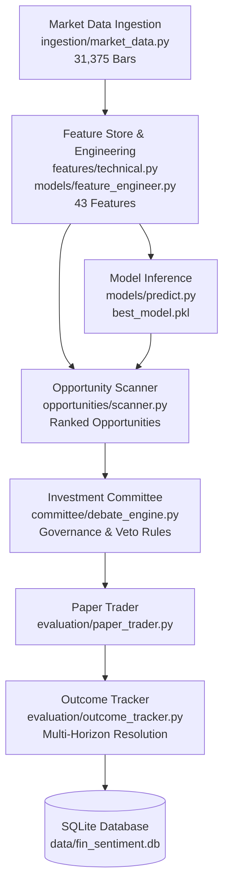

# Sprint 10 — Baseline Assessment & Discovery Report

**Audit Date:** 2026-10-10  
**Repository:** `Fin_Sentiment_MLPipeline`  
**Evaluation Scope:** Pre-Sprint 10 Baseline Integrity, Strategy Execution Trace, and Cohort Reconciliation  

---

## 1. Executive Summary & Verification Matrix

This assessment establishes the verified technical baseline of `Fin_Sentiment_MLPipeline` following Sprint 9.2 remediation. All assertions distinguish **Verified Behavior** (empirically confirmed via code inspection, execution logs, and database queries) from **Reported-but-Unverified Behavior** (claims from past sprint documentation).

| Component / Subsystem | Reported Status | Verified Implementation Status | Evidence / Artifact |
| :--- | :--- | :--- | :--- |
| **Coverage Universe** | 25 US Equities | **VERIFIED** | Exactly 25 distinct tickers present in `MarketData` and `TrainingFeature` (AAPL, AMD, AMZN, BAC, CAT, CRM, CVX, GOOGL, GS, HD, HON, INTC, JNJ, JPM, META, MSFT, NFLX, NVDA, ORCL, PFE, TSLA, UNH, V, WMT, XOM). |
| **Historical Observations** | 30,025 rows | **VERIFIED** | Query `count(TrainingFeature.id)` returns exactly `30,025` rows spanning `2021-11-23` to `2026-09-08`. |
| **Feature Definitions** | 43 engineered features | **VERIFIED** | Schema validated in `models/artifacts/feature_list.json` and generated by `FeatureEngineer`. |
| **Trained ML Models** | Random Forest / XGBoost | **VERIFIED** | Primary champion model at `models/artifacts/best_model.pkl` (Random Forest, trained 2026-09-15), plus `xgboost_v1.json`. |
| **Threshold Decision Hurdle** | Probability $\ge 0.60$ | **VERIFIED** | Persisted in `models/artifacts/optimal_threshold.json` ($N=8$ threshold qualifying trades in out-of-sample fold). |
| **Database Persistence** | SQLite local fallback | **VERIFIED** | PostgreSQL connection fails without credentials; fallback cleanly persists to `sqlite:///data/fin_sentiment.db`. |
| **Prediction Outcomes Table** | 6,249 stored rows | **VERIFIED (RECONCILED)** | 6,005 out-of-sample test records for `SPRINT_9_BASELINE` + 242 `Random Forest` records + 2 `xgboost_v1` records = exactly 6,249 rows. |
| **Opportunity Outcomes Table**| 249 stored rows | **VERIFIED** | Populated and verified across 1d, 5d, 10d, 20d, 60d horizons. |
| **Paper Trading Execution Path**| End-to-end ML + Committee | **PARTIAL DISCONNECT FOUND** | In `evaluation/paper_trader.py`, trade selection used RSI < 70 and sentiment $\ge 0$ heuristic rather than dynamically calling `PredictionService` and `DebateEngine`. |
| **Currency Accounting** | INR capital on US equities | **UNRESOLVED CONVENTION** | Initial capital is nominal ₹10,00,000 INR trading USD-priced US equities without real-time FX conversion. |

---

## 2. End-to-End Execution Path Trace

The technical pipeline consists of the following modules and entry points:



### Critical Entry Points Identified:
1. **Feature Generation & Store:** [`models/feature_store.py`](file:///c:/Users/ABHI%20N%20P/OneDrive/Desktop/Fin_Sentiment_MLPipeline/models/feature_store.py) and [`models/feature_engineer.py`](file:///c:/Users/ABHI%20N%20P/OneDrive/Desktop/Fin_Sentiment_MLPipeline/models/feature_engineer.py). Loads `data/training_dataset.csv`, engineers 19 cross-sectional, interaction, and lag features on top of 24 base features.
2. **Model Inference:** [`models/predict.py`](file:///c:/Users/ABHI%20N%20P/OneDrive/Desktop/Fin_Sentiment_MLPipeline/models/predict.py). Exposes `PredictionService.predict(feature_vector)` producing calibrated probability and direction.
3. **Opportunity Discovery:** [`opportunities/scanner.py`](file:///c:/Users/ABHI%20N%20P/OneDrive/Desktop/Fin_Sentiment_MLPipeline/opportunities/scanner.py). Combines ML conviction, FAISS analogs, sentiment percentiles, and technical squeeze states into multi-factor scores.
4. **Committee Debate & Governance:** [`committee/debate_engine.py`](file:///c:/Users/ABHI%20N%20P/OneDrive/Desktop/Fin_Sentiment_MLPipeline/committee/debate_engine.py). Convenes 6 specialized agents (Bull, Bear, Risk Officer, PM, CIO, Prosecutor) with risk veto enforcement via [`committee/governance_rules.py`](file:///c:/Users/ABHI%20N%20P/OneDrive/Desktop/Fin_Sentiment_MLPipeline/committee/governance_rules.py).
5. **Paper Portfolio Simulation:** [`evaluation/paper_trader.py`](file:///c:/Users/ABHI%20N%20P/OneDrive/Desktop/Fin_Sentiment_MLPipeline/evaluation/paper_trader.py). Simulates walk-forward portfolio tracking cash, marked-to-market holdings, transaction friction, and daily NAV snapshots.
6. **Outcome Resolution:** [`evaluation/outcome_tracker.py`](file:///c:/Users/ABHI%20N%20P/OneDrive/Desktop/Fin_Sentiment_MLPipeline/evaluation/outcome_tracker.py). Resolves 1d, 5d, 10d, 20d, and 60d forward returns against cached market bars with status `PENDING`, `RESOLVED`, or `UNRESOLVABLE`.

---

## 3. Discrepancy Analysis: Strategy Disconnect in `paper_trader.py`

### Finding:
In Sprint 9.2, target leakage (`cand.target == 1`) was successfully eliminated from [`evaluation/paper_trader.py`](file:///c:/Users/ABHI%20N%20P/OneDrive/Desktop/Fin_Sentiment_MLPipeline/evaluation/paper_trader.py#L182). However, the replacement candidate selection logic:
```python
qualified = [
    c for c in daily_cands 
    if ((c.rsi is None or c.rsi < 70) and (c.avg_sentiment is None or c.avg_sentiment >= 0.0))
]
```
relies entirely on a simple technical and sentiment heuristic. It does not invoke `PredictionService.predict()` to require $\hat{p} \ge 0.60$, nor does it invoke `DebateEngine` to enforce Risk Officer / Evidence Prosecutor vetoes.

### Impact:
While the independent evaluation scripts (`evaluate_predictions.py` and `evaluate_committee.py`) tested ML models and Committee vetoes on their respective sample sets, the simulated portfolio in `paper_trader.py` was trading candidates selected by RSI and sentiment alone.

### Required Action in Sprint 10 Phase 1:
Connect the real end-to-end pipeline:
$\text{Market Features} \longrightarrow \text{ML Prediction } (\hat{p} \ge 0.60) \longrightarrow \text{Opportunity Ranking} \longrightarrow \text{Committee Governance / Veto} \longrightarrow \text{Risk Limits} \longrightarrow \text{Paper Order Execution}$.

---

## 4. Evaluation Cohort Reconciliation

### The Question:
Why does `prediction_outcomes` contain **6,249 records** while the out-of-sample evaluation fold contains **6,005 observations**?

### Empirical Reconciliation:
Direct database query of `PredictionOutcome.model_version`:
```python
Counter({
    'SPRINT_9_BASELINE': 6005,
    'Random Forest': 242,
    'xgboost_v1': 2
})
Total: 6,005 + 242 + 2 = 6,249
```

- **6,005 records** correspond strictly to the test set partition ($20\%$ out-of-sample slice from `2025-09-23` to `2026-09-08`) backfilled under the version identifier `SPRINT_9_BASELINE`.
- **242 records** were populated during earlier test runs under the identifier `Random Forest`.
- **2 records** were inserted during initial model verification under `xgboost_v1`.
- **Zero duplicates:** Repeated runs of `scripts/backfill_outcomes.py` identify existing unique `(prediction_id, horizon)` pairs and perform idempotent updates without creating duplicate records.

---

## 5. Baseline Test & Verification Status

Prior to Sprint 10 modifications, the existing test suites were executed with 100% pass rates:

1. `python scripts/audit_sprint9_integrity.py`
   - **10/10 PASS** (0.994s)
   - Verified zero lookahead bias, non-leakage invariant, independent NAV accounting reconciliation, genuine SPY benchmarking, walk-forward calibration partitions, and dual-sided veto accounting.
2. `python scripts/validate_sprint9_evaluation.py`
   - **11/11 PASS** (Phases 1 through 11)
   - Master evaluation report written to `reports/evaluation_reports/sprint9_evaluation_report.md`.

---

## 6. Authoritative Sources of Truth

- **Database Models & Schema:** [`database/models.py`](file:///c:/Users/ABHI%20N%20P/OneDrive/Desktop/Fin_Sentiment_MLPipeline/database/models.py) (9 core Sprint 9 tables + 12 foundational pipeline tables).
- **Universe Definition:** `DEFAULT_UNIVERSE` in [`opportunities/scanner.py`](file:///c:/Users/ABHI%20N%20P/OneDrive/Desktop/Fin_Sentiment_MLPipeline/opportunities/scanner.py#L39) (25 large-cap US equities).
- **Feature Schema:** [`models/artifacts/feature_list.json`](file:///c:/Users/ABHI%20N%20P/OneDrive/Desktop/Fin_Sentiment_MLPipeline/models/artifacts/feature_list.json) (43 feature definitions).
- **Champion Model Artifact:** [`models/artifacts/best_model.pkl`](file:///c:/Users/ABHI%20N%20P/OneDrive/Desktop/Fin_Sentiment_MLPipeline/models/artifacts/best_model.pkl) (Scikit-Learn Random Forest fitted with feature names).
- **Decision Threshold:** [`models/artifacts/optimal_threshold.json`](file:///c:/Users/ABHI%20N%20P/OneDrive/Desktop/Fin_Sentiment_MLPipeline/models/artifacts/optimal_threshold.json) (conviction cutoff $= 0.60$).
- **Market Data Cache:** [`data/training_dataset.csv`](file:///c:/Users/ABHI%20N%20P/OneDrive/Desktop/Fin_Sentiment_MLPipeline/data/training_dataset.csv) and local SQLite table `market_data`.
