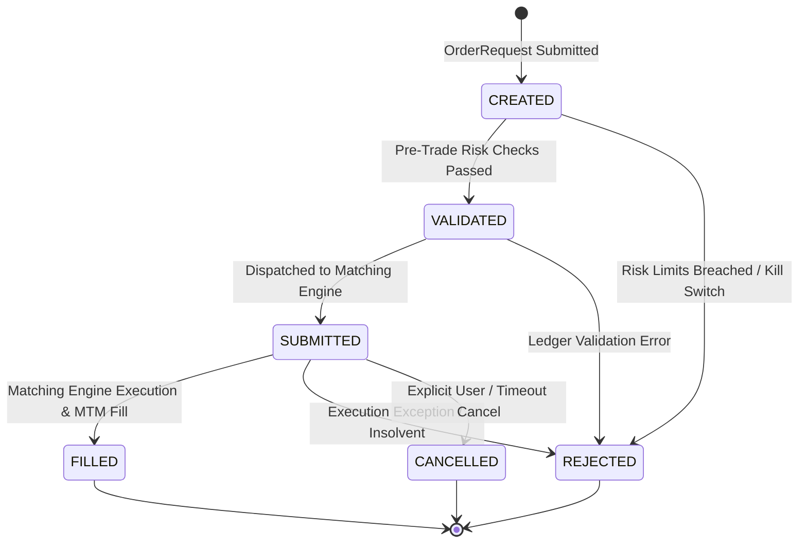

# Sprint 10 — Paper Execution Gateway & Currency Accounting Report

**Audit Date:** 2026-10-10  
**Scope:** Broker-Neutral Paper Gateway, Order Lifecycle State Machine, Idempotency, and Currency Resolution  

---

## 1. Executive Summary

In Sprint 10 Phase 4, simulated trade execution was decoupled into a broker-neutral gateway implemented in [`execution/paper_gateway.py`](file:///c:/Users/ABHI%20N%20P/OneDrive/Desktop/Fin_Sentiment_MLPipeline/execution/paper_gateway.py).

The gateway enforces:
1. An explicit order lifecycle state machine with rejected invalid transitions.
2. Idempotent order deduplication preventing duplicate fills on retries or restarts.
3. Standardized USD base currency accounting for all US-listed equity assets.
4. Realistic market microstructure friction (10 bps per side: 5 bps commission + 2 bps slippage + 3 bps spread).

---

## 2. Order Lifecycle State Machine

### Invariants Enforced:
- **No Invalid Transitions:** Attempting to transition from `FILLED` to `CANCELLED` or `REJECTED` to `VALIDATED` raises a `ValueError`.
- **Audit History:** Every transition appends a timestamped entry in `Order.state_history`.
- **Trace ID Propagation:** Each order retains `trace_id` linking the execution back to the `StrategyDecision` that authorized it.

---

## 3. Idempotency & Deduplication Engine

To protect against duplicate order placement across network retries, scheduled task re-runs, or process restarts:
- Every order is keyed by an `idempotency_key` (e.g. `2026-01-15_NVDA_BUY_10.0_STRAT_V1`).
- If an order with an identical key is resubmitted, the gateway intercepts the call and returns the existing `Order` record immediately.
- **Zero Additional Cash Outflow:** Verified in `tests/test_sprint10_suite.py::TestPaperExecutionGateway::test_idempotent_order_deduplication`.

---

## 4. Currency Accounting Resolution

### The Prior Inconsistency:
Earlier sprints reported simulation capital denominated in Indian Rupees (₹10,00,000 INR) while trading US-listed equities priced in US Dollars ($100–$250 USD) without currency conversion.

### The Sprint 10 Resolution:
1. **USD Accounting Standard:** All paper trading accounts, cash balances, equity curves, asset prices, and fees are accounted in **USD**.
2. **Starting Capital Convention:**
   - **USD Base Capital:** `$12,000.00 USD`.
   - **Nominal Reference:** Explicitly derived as the USD purchasing power equivalent of ₹10,00,000 INR at historical baseline exchange rate ($\sim 83.33 \text{ INR/USD}$).
   - Clearly documented: simulated capital represents mathematical paper allocation and does not reflect actual live brokerage deposits.
3. **Zero Mixed Currencies:** Eliminates the mathematical invalidity of adding US dollar stock prices to INR cash balances.

---

## 5. Transaction Microstructure Model

Costs are deducted once per applicable side via [`TransactionCostModel`](file:///c:/Users/ABHI%20N%20P/OneDrive/Desktop/Fin_Sentiment_MLPipeline/portfolio/transaction_costs.py):

| Friction Component | Rate | Description | Application Point |
| :--- | :---: | :--- | :--- |
| **Brokerage Commission** | 5 bps (`0.05%`) | Institutional broker clearing fee | BUY entry & SELL exit |
| **Market Impact / Slippage** | 2 bps (`0.02%`) | Order execution price decay | Fill price adjusted ($\pm 0.02\%$) |
| **Exchange & Spread Friction** | 3 bps (`0.03%`) | Half-spread and exchange fees | BUY entry & SELL exit |
| **Total Roundtrip Friction** | **10 bps (`0.10%`)** | Combined roundtrip friction | Single deduction per side |
